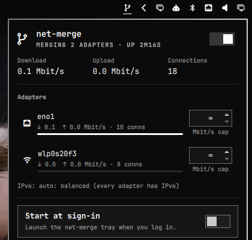

# net-merge for Omarchy

A bar plugin for [net-merge](https://net-merge.org), which spreads every new connection across Wi-Fi, Ethernet and phone tethers so you get their combined speed.



- **On/off switch:** turn merging on or off from the bar. If the net-merge tray isn't running, the plugin starts it for you.
- **Live speeds:** combined download, upload and connection count, with a bar showing each adapter's share.
- **Per-adapter caps:** set a Mbit/s limit for each adapter in place (∞ means no limit).
- **Start at sign-in:** a switch for `net-merge autostart`.

## Install

You need net-merge 0.3 or newer (see [net-merge.org](https://net-merge.org) for the Arch repo). Then:

```bash
omarchy plugin add https://github.com/Auzzpiciouzz/net-merge --enable
```

The widget goes on the right of the bar by default. To put it right before the network icon, or tuck it into the tray drawer:

```bash
omarchy bar move net-merge --section right --before omarchy.network
omarchy bar move net-merge --section tray
```

## Remove

```bash
omarchy plugin remove net-merge
```

This removes only the widget. net-merge itself stays installed. If you turned on "Start at sign-in" and don't want it anymore, run `net-merge autostart off` first.

## Using it

| Input | Action |
|---|---|
| Left click | Open the panel |
| Right click | Toggle merging |
| Middle click | Refresh |
| `t` / Space in the panel | Toggle merging |
| ↑ ↓ and Enter in the panel | Move between controls and activate them |

From scripts:

```bash
omarchy-shell net-merge toggleMerging   # also: on, off, status, open, close
```

## Settings

Change these in the bar's widget settings or in `~/.config/omarchy/shell.json`:

| Key | Default | |
|---|---|---|
| `barLabel` | `Icon only` | `Combined speed` shows the download rate next to the icon while merging |
| `hideWhenOff` | `false` | Show the icon only while merging |
| `refreshIntervalSec` | `5` | How often the closed widget polls (2–60s). The open panel refreshes every 2s |

## How it works

The plugin never runs net-merge with elevated privileges. The Arch package already gives `/usr/bin/net-merge` the `cap_net_admin` capability. Every call goes through `bin/net-merge-ctl`, which:

- passes adapter names and numbers to net-merge as arguments, never through a shell string, and validates them first;
- makes sure the tray is running before `net-merge on`. Without a tray, `on` runs in the foreground and blocks;
- wraps every call in a timeout.

net-merge's own tray icon also shows up in Omarchy's tray. You can hide it from the tray's manage menu (right click on the chevron) if you only want this widget.

## Development

```bash
node tests/run.js                     # parser tests, run against real net-merge output
omarchy plugin validate .
```

QML edits sometimes stay cached after the hot reload. If a change doesn't show up, run `omarchy restart shell`.

## License

MIT
